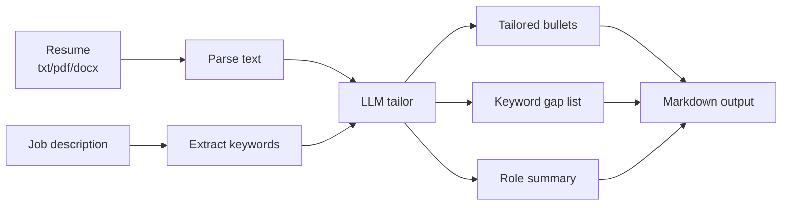

<!-- Banner -->
<p align="center">
  
</p>

# Resume Tailoring Tool


> Feed a job description + your resume → tailored bullets, keyword gaps, and a tuned summary.
>
> **Skills:** prompting, document parsing, guardrails · **Level:** 🟡 Intermediate · **Courses:** Gen AI + Intro to AI

---

## Table of Contents
1. [Overview](#overview)
2. [Goals & Objectives](#goals--objectives)
3. [Architecture](#architecture)
4. [Project Structure](#project-structure)
5. [Pro-Level Build Prompt (copy & reuse)](#pro-level-build-prompt-copy--reuse)
6. [Tech Stack](#tech-stack)
7. [Setup](#setup)
8. [Security & Secrets](#security--secrets)
9. [Testing](#testing)
10. [Roadmap](#roadmap)

---

## Overview

Reads your resume and a target job description, extracts the role's key requirements, and produces tailored bullet points, a keyword gap list, and a 2-line role-specific summary — with a hard guardrail that forbids inventing experience.

## Goals & Objectives

**Goal:** Align a real resume to a specific role without fabricating anything.

**Objectives**
- Parse resumes from txt/md/pdf/docx.
- Extract JD keywords and requirements.
- Generate tailored bullets + gap list + summary.
- Enforce a no-fabrication guardrail.

## Architecture



## Project Structure

```
resume-tailoring-tool/
├── tailor.py               # CLI entrypoint
├── core/
│   ├── parse.py            # resume text extraction
│   ├── jd.py               # JD keyword extraction
│   └── tailor.py           # LLM tailoring + guardrail
├── tests/
├── requirements.txt
├── .env.example
└── .gitignore
```

## Pro-Level Build Prompt (copy & reuse)

> Paste the block below into a senior-grade coding assistant (Claude, GPT, Gemini).
> It is written as a full engineering spec: role, context, goals, requirements,
> plan, and constraints. **It explicitly forbids leaking secrets.**

````text
ROLE
You are a senior Python engineer with NLP experience. Deliver modular, commented,
tested code.

CONTEXT
Build a "Resume Tailoring Tool" that aligns a candidate's resume to a specific
job description using an LLM API. Output is Markdown.

GOAL
Tailor a REAL resume to a role without fabricating any experience.

FUNCTIONAL REQUIREMENTS
1. Inputs
   - Resume file: .txt/.md/.pdf/.docx (extract clean text).
   - Job description: text or file.
2. Processing
   - Extract the JD's key requirements/keywords.
   - Produce: (a) tailored bullet points, (b) keyword gap list (JD terms missing
     from the resume), (c) a 2-line summary tuned to the role.
3. Guardrail (critical)
   - Instruct the model to NEVER invent achievements, employers, dates, or
     metrics. It may rephrase/emphasize existing content only.
4. Output
   - Write a clean Markdown report (--out).

NON-FUNCTIONAL REQUIREMENTS
- Security/privacy: API key from .env only; never log full resume content or
  secrets. Fail fast if key missing.
- Robustness: handle unreadable/empty files with clear errors.
- Quality: type hints, docstrings, small functions.

SUGGESTED STRUCTURE
tailor.py (CLI) -> core/parse.py, core/jd.py, core/tailor.py

IMPLEMENTATION PLAN
Phase 1: resume parsers (txt/md/pdf/docx) + tests.
Phase 2: JD keyword extraction.
Phase 3: tailoring prompt with explicit no-fabrication guardrail.
Phase 4: Markdown writer + CLI + README.

TESTING
- pytest, LLM mocked. Cover each file type, empty file, and verify the guardrail
  instruction is always present in the system prompt.

DELIVERABLES
- Source, requirements.txt, .env.example (placeholders), .gitignore, tests.

CONSTRAINTS
- No secret leakage. No fabricated resume content. Minimal pinned deps.

````

## Tech Stack

| Layer | Choice | Why |
|---|---|---|
| Language | Python 3.11+ | fast iteration |
| LLM | OpenAI / Gemini | tailoring + extraction |
| Parsing | `pypdf`, `python-docx` | read resumes |
| Config | `python-dotenv` | secret-free |

## Setup

```bash
# 1. Create an isolated environment
python -m venv .venv
source .venv/bin/activate        # Windows: .venv\Scripts\activate

# 2. Install dependencies
pip install -r requirements.txt

# 3. Configure secrets (never commit the real .env)
cp .env.example .env             # then edit .env and add your API key

# 4. Run
python tailor.py --resume resume.pdf --jd job.txt --out tailored.md
```

## Security & Secrets

- **No keys in code.** All credentials load from `.env` via `python-dotenv`.
- `.env` is git-ignored; only `.env.example` (with placeholder values) is committed.
- The app **fails fast** with a clear message if a required key is missing.
- Never log full prompts/responses that may contain secrets or personal data.
- Pin dependencies in `requirements.txt`; review before upgrading.

```ini
# .env.example  (commit this — values are placeholders)
OPENAI_API_KEY=your_key_here
# GEMINI_API_KEY=your_key_here
MODEL=gpt-4o-mini
```

## Testing

```bash
pytest -q                        # unit tests for core logic (mock the LLM calls)
```

- Mock the LLM client so tests are deterministic and run offline.
- Cover: happy path, empty/invalid input, and malformed model output.

## Roadmap

- [ ] Match score (resume ↔ JD)
- [ ] Compare against multiple JDs
- [ ] Cover-letter draft
- [ ] ATS keyword density check

---

<sub>Part of the **Tier 2 — AI & Prompt Engineering** demo set. Educational project. MIT License.</sub>
